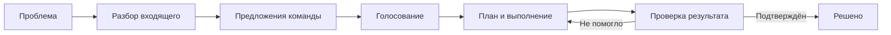

# МОДУС · СИГНАЛ

**Есть проблема — решаем командой.** Сотрудники предлагают варианты, голосуют за лучший, выполняют план и получают монеты за участие. Руководитель видит, на каком этапе нужна помощь, и задаёт сроки для каждой проблемы.

[Открыть демо](https://kirillzakup.github.io/modus-signal/) · [Развёртывание](docs/DEPLOYMENT.md) · [Исходный код](https://github.com/kirillzakup/modus-signal)

[](https://codespaces.new/kirillzakup/modus-signal)

Проект команды **JuniorProg** для хакатона **Pavlodar Hub и ГК «Модус Трейд»**: браузерный интерфейс, сервер на Node.js, вариант развёртывания в Cloudflare и интеграция с Telegram. Публичная демо-копия использует учебные данные. Она не подключена к рабочей базе компании.

## Зачем нужен «Сигнал»

Проблемы часто остаются в переписке: кто-то пожаловался, несколько человек согласились, но дальнейшие действия не определены. «Сигнал» собирает обсуждение, решение и результат в одной карточке.

- Автор описывает конкретную проблему и ожидаемый результат.
- Команда сначала предлагает решения, затем голосует.
- У каждого этапа есть срок и понятное следующее действие.
- Выбранное решение превращается в план с исполнителями.
- Закрытие требует результата и проверки эффекта.
- Участие отражается в истории монет; монеты можно обменять на награды.

## Попробовать без установки

Откройте [публичную демонстрацию](https://kirillzakup.github.io/modus-signal/). Переключатель пользователей позволяет пройти сценарий за сотрудника, ответственного и собственника. В рабочей версии права определяются аккаунтом после входа.

В GitHub Pages нет сервера: данные демо сохраняются в браузере, ИИ показан учебными ответами, а Telegram-регистрация и отправка сообщений не выполняются. Изменения в одном браузере не видны другим участникам. Для общей базы нужен сервер.

### Сценарий для жюри: от проблемы до награды

1. **Откройте карточку или создайте проблему.** Например: «В переговорной периодически пропадает изображение». Опишите, когда это происходит и чему мешает.
2. **Перейдите к собственнику.** Разберите входящее обращение, назначьте ответственного и сроки. Отдельно задайте срок предложений, голосования и решения.
3. **Вернитесь к сотрудникам.** Каждый участник предлагает свой вариант: проверить кабель, заменить переходник, настроить постоянное подключение. Укажите ожидаемый эффект. Если своего варианта нет, отметьте, что ознакомились.
4. **Завершите сбор предложений.** Голосование начинается следующим этапом: варианты не выбираются одновременно с их сбором. Интерфейс показывает, чьего участия ещё ждёт команда.
5. **Проголосуйте разными участниками.** После завершения этапа определяется лидер. При равенстве голосов ответственный выбирает из лидеров и объясняет решение.
6. **Составьте план.** Добавьте конкретные шаги, исполнителей и сроки: проверить подключение, установить исправный кабель, провести несколько встреч без сбоев.
7. **Зафиксируйте выполнение.** Отметьте шаги, запишите результат и проверьте, устранилась ли проблема. При отрицательной проверке верните её в работу.
8. **Откройте профиль и магазин.** Посмотрите начисления за участие, выберите доступную награду и оформите заявку. Уполномоченный сотрудник обрабатывает её; списание монет не означает автоматическую выдачу реального приза.

Сроки каждого обсуждения устанавливает руководитель. Этап можно завершить раньше, когда ответили все участники. Если никто не предложил решение, карточка требует внимания, а не исчезает как выполненная.

## Как устроена работа



| Участник | Что делает |
| --- | --- |
| Сотрудник | Сообщает о проблеме, предлагает решение, голосует, выполняет свои шаги, выбирает награды |
| Ответственный / руководитель | Назначает сроки, сопровождает обсуждение, организует выполнение и проверку |
| Собственник | Разбирает входящие, следит за общим состоянием, рассматривает отчёт и поощрения |
| Администратор | Управляет доступом, сотрудниками и настройками |

При регистрации сотрудник указывает имя и должность. Поле подразделения не требуется для основного пользовательского сценария. Должность описывает человека; административные права выдаются отдельно.

### Монеты и награды

Основные действия командного сценария:

| Действие | Монеты |
| --- | ---: |
| Предложить решение | +5 |
| Проголосовать | +2 |
| Стать автором выбранного варианта | +15 |
| Довести улучшение до результата | +10 |

За предложение и голос бонус начисляется один раз на сотрудника в каждой проблеме. Повторное нажатие не увеличивает баланс. В профиле видны причины начислений. Каталог и порядок выдачи наград настраивает компания; монеты — внутренняя мотивация, а не платёжная валюта.

### Личный ИИ-помощник

Помощник помогает сформулировать проблему, уточнить причины, придумать несколько вариантов, сравнить риски и определить следующий шаг. Его можно спросить в контексте доступной карточки или со своим черновиком.

В серверной версии запрос проходит через `server/personal-assistant.js` к DeepSeek. Браузер не получает API-ключ. Помощник получает ограниченный контекст выбранной карточки и переданную историю диалога; он не читает закрытые отчёты и чужие недоступные обращения.

Помощник не голосует, не выбирает победителя, не изменяет карточки и не начисляет монеты. Ответ — совет для сотрудника, который сам принимает и публикует решение.

Для настоящих ответов нужны **ключ DeepSeek и доступный баланс API**. Наличие ключа само по себе не гарантирует ответ. При отсутствии настройки, исчерпанном балансе или ошибке сервиса приложение показывает причину; сервер не подменяет её выдуманным успешным ответом. Статическая демонстрация отдельно использует учебные ответы.

### Отчёт собственника

Кабинет собственника собирает состояние открытых проблем, сроки, участие сотрудников и результаты. Ежедневная сводка предназначена для решения конкретных вопросов: где нужно вмешательство, кто ждёт следующего шага и какие улучшения завершены.

Отчёт и его PDF относятся к серверному сценарию. Фактические показатели берутся из данных приложения; рекомендации помощника следует отличать от зарегистрированных событий. Публичное демо не отправляет рабочие отчёты в Telegram.

Серверные маршруты отчётов: `GET /api/owner/reports`, `POST /api/owner/report`, `GET /api/owner/reports/:id/pdf`. Доступ к ним проверяется по правам пользователя.

## Выберите способ запуска

| Способ | Что доступно | Где данные |
| --- | --- | --- |
| GitHub Pages | Интерфейс, учебные роли, командный сценарий, демо наград и ИИ | Браузер посетителя |
| GitHub Codespaces | Node.js-сервер и API для разработки; можно подключить собственный DeepSeek | Файлы вашего codespace |
| Локальный Node.js / Docker | Сервер, SQLite, API, разработка и проверка интеграций | Каталог `data/` или Docker volume |
| Cloudflare | HTTPS-приложение, серверная авторизация, общая база, Telegram и DeepSeek | Durable Object с SQLite |

GitHub Pages не запускает Node.js, не хранит серверные секреты и не заменяет Cloudflare. Codespaces — среда разработки; доступность и квоты зависят от аккаунта GitHub. Не используйте её как обещание постоянного бесплатного хостинга.

## Локальный запуск

Нужны Git и **Node.js 24**. В проекте используется встроенный `node:sqlite`; старые версии Node.js не подходят.

```bash
git clone https://github.com/kirillzakup/modus-signal.git
cd modus-signal
npm ci
npm start
```

Откройте `http://localhost:8080`. Демо-данные создаются автоматически. Остановка — `Ctrl+C`; после перезапуска сервер читает сохранённую базу из `data/`.

Режим `DEMO=1` допускает выбор учебного пользователя. Он удобен для хакатона и локальной проверки, но не является защищённой авторизацией для рабочей компании. Подробности серверного запуска — в [инструкции развёртывания](docs/DEPLOYMENT.md).

### Запуск прямо из GitHub

1. Нажмите кнопку **Open in GitHub Codespaces** в начале README.
2. Создайте codespace и дождитесь установки зависимостей.
3. Контейнер запустит `npm start` и пробросит порт `8080`.
4. Откройте этот порт из панели **Ports**. Если окно не открылось автоматически, нажмите значок браузера рядом с портом.
5. После демонстрации остановите codespace. Лог сервера находится в `/tmp/modus-signal.log`.

Порт с демо-доступом оставляйте приватным. Для ручного запуска после остановки сервера выполните `npm start` в терминале codespace.

### Docker

```bash
docker build -t modus-signal .
docker run --rm -p 127.0.0.1:8080:8080 -v modus-data:/data modus-signal
```

Именованный том сохраняет базу между запусками. Образ устанавливает production-зависимости из `package-lock.json` и работает от пользователя `node`.

## Настройка DeepSeek локально

Создайте локальный файл `.env` с нужными значениями. Не добавляйте его в Git:

```dotenv
DEMO=1
DEEPSEEK_API_KEY=your_deepseek_api_key
DEEPSEEK_MODEL=deepseek-flash
```

Загрузите переменные явно:

```bash
node --env-file=.env --disable-warning=ExperimentalWarning server/index.js
```

Обычный `npm start` читает окружение процесса и сам по себе не загружает `.env`. Для Cloudflare используйте секрет Worker, а не этот файл. API и возможные расходы описаны в [официальной документации DeepSeek](https://api-docs.deepseek.com/).

## Проверки и сборка

```bash
npm test
npm run build
npm run build:cloudflare
```

- `npm test` запускает тесты правил, API, авторизации и интеграционных сценариев. Тесты помощника используют подставные ответы, без платных запросов DeepSeek.
- `npm run build` создаёт автономный HTML и каталог `dist/pages/` для публичного демо.
- `npm run build:cloudflare` проверяет сборку Worker в режиме `--dry-run`; эта команда не публикует приложение.

Workflow [Tests and GitHub Pages](.github/workflows/pages.yml) устанавливает зависимости, запускает тесты и сборку. Успешная проверка ветки `main` публикует только `dist/pages/`. Pull request проходит проверки без публикации.

## Архитектура

```text
public/                  интерфейс, стили и общие правила
  core.js                права, карточки, этапы, голосование, монеты
  team-ui.js             командное обсуждение и подсказки следующего действия
server/                  Node.js API, SQLite, фоновые задачи
  personal-assistant.js  серверный клиент DeepSeek
cloudflare/              Worker, Durable Object, сессии, Telegram, файлы
scripts/                 сборка автономного демо и инструменты развёртывания
tests/                   проверки правил и серверных сценариев
.github/workflows/       CI и публикация GitHub Pages
.devcontainer/           готовая среда Codespaces
```

Ядро правил используется и в браузерном демо, и на сервере. В Cloudflare изменения общей компании сериализуются; ожидание ответа DeepSeek вынесено из очереди, чтобы не блокировать других сотрудников. После ответа доступ пользователя проверяется повторно.

API личного помощника:

| Метод | Путь | Назначение |
| --- | --- | --- |
| GET | `/api/health` | Состояние сервера и настройки помощника без ключа |
| GET | `/api/assistant/info` | Доступность и модель помощника после входа |
| POST | `/api/assistant/ask` | Вопрос, необязательный черновик, карточка и история |

Помощник ограничивает вопрос 3000 символами и историю восемью сообщениями. Одновременно обрабатывается один запрос пользователя; лимит — десять в минуту. Ожидание ответа ограничено по времени. Эти ограничения не заменяют контроль расходов в кабинете API.

## Безопасность и границы демонстрации

- В публичный репозиторий не включаются ключи, токены бота, рабочая SQLite-база, личные документы и приватные отчёты.
- Реальная регистрация сотрудников через Telegram предусмотрена в Cloudflare-варианте; сервер проверяет подпись Telegram и членство в настроенной группе.
- Отдельный вход администратора и собственника относится к серверной конфигурации Cloudflare. Переключатель ролей в демо существует для показа сценариев.
- Доступ к карточке проверяется на сервере. Скрытая кнопка в браузере не считается проверкой прав.
- Текст карточки, отправленный в DeepSeek по запросу сотрудника, передаётся внешнему поставщику API. Не размещайте в демонстрации реальные конфиденциальные данные.
- Telegram, выдача наград и отчёты требуют своей настройки и уполномоченного ответственного; публичное демо не совершает эти действия в рабочей компании.
- Полный экран зависит от браузера и Telegram-клиента; при необходимости пользователь нажимает кнопку «На весь экран».

## Ограничения и развитие

Это рабочая демонстрация продукта и его серверной архитектуры. Перед внедрением в организацию нужны настройка учётных записей, каталога наград, расписания, резервного копирования и проверка сценариев на её данных.

Node.js и Cloudflare используют разные механизмы входа и хранения. Перенос базы между ними не выполняется автоматически. Старые интеграционные модули могут оставаться в исходниках, но основная презентация строится вокруг простого командного цикла: предложение → голосование → выполнение → результат.

Лицензия проекта отдельно не назначена. Наличие публичного репозитория само по себе не означает разрешения на любое использование кода; условия следует согласовать с правообладателем.
